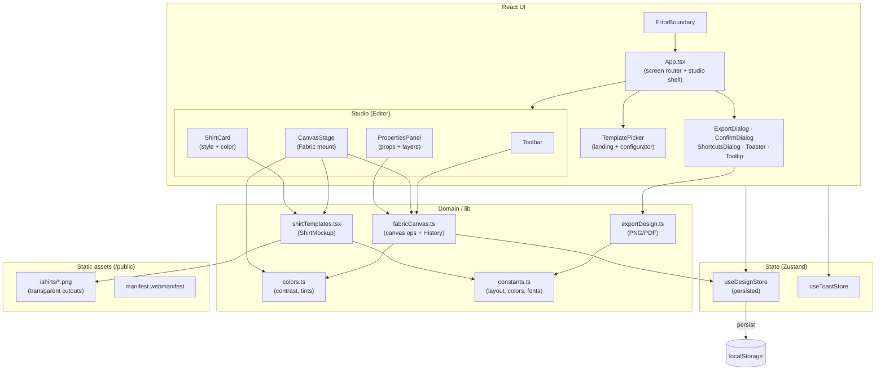
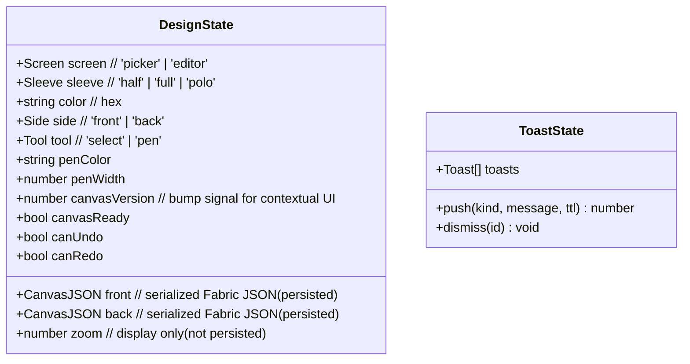
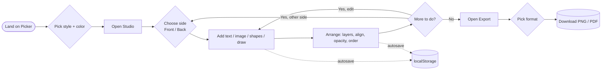
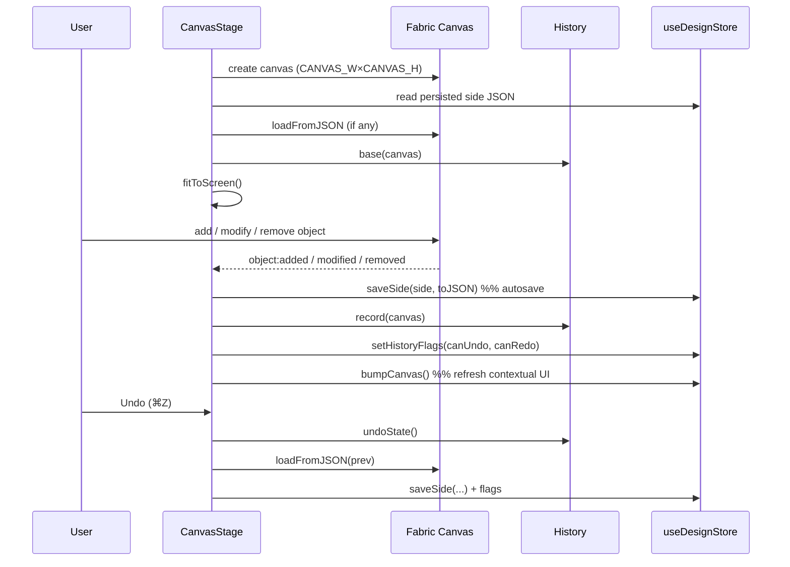
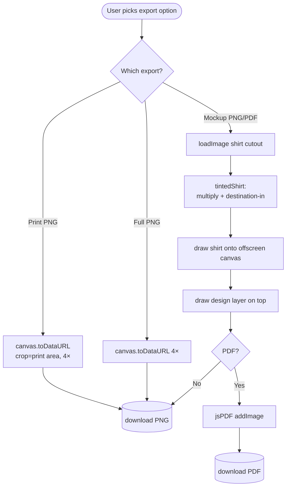
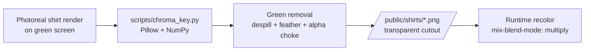

# Tee Studio — Product & Technical Specification

> Custom T‑shirt design studio that runs entirely in the browser. Pick a shirt
> style and color, customize the front and back with text, artwork, shapes, and
> freehand drawing, preview a realistic mockup, and export print‑ready files.

- **Type:** Client‑only Single Page Application (SPA). No backend, no sign‑up.
- **Stack:** Vite + React 18 + TypeScript + Fabric.js + Zustand + Tailwind CSS.
- **Persistence:** Browser `localStorage` (auto‑save). Works offline after first load.
- **Status:** Production‑ready demo (v1.0.0).

---

## 1. Goals & Non‑Goals

### Goals
- Let a non‑designer create a print‑ready T‑shirt design in minutes.
- Provide **half‑sleeve**, **full‑sleeve**, and **polo (collared)** styles in a curated set of fabric colors.
- Support **front and back** designs independently.
- Offer core design tools: text, image upload, freehand pen, shapes, layers.
- Produce **high‑resolution, print‑ready** output (PNG + PDF).
- Be fully usable on **desktop, iPad, and phone**, including touch.

### Non‑Goals (v1)
- User accounts, cloud storage, or collaboration.
- Order fulfillment / checkout / payment.
- Server‑side rendering or a public API.
- Pinch‑to‑zoom of the whole stage (zoom is via the on‑screen control).

---

## 2. Functional Requirements

IDs are grouped by area. Each requirement notes where it is implemented.

### 2.1 Shirt selection (Picker / Configurator)
| ID | Requirement | Implementation |
|----|-------------|----------------|
| FR‑S1 | User can choose shirt style: **Half sleeve**, **Full sleeve**, or **Polo** (collared). | `TemplatePicker`, `App/ShirtCard`, `useDesignStore.sleeve` |
| FR‑S2 | User can choose from **15+ fabric colors** plus a **custom hex** picker. | `ColorSwatches`, `SHIRT_COLORS` |
| FR‑S3 | Shirts are **plain** photorealistic mockups, recolored live. | `ShirtMockup`, `mix-blend-mode: multiply` |
| FR‑S4 | A live preview reflects the selected style and color instantly. | `ShirtMockup` in picker + studio |
| FR‑S5 | User can open the selected shirt in the studio (editor). | `openEditor()` |
| FR‑S6 | Showcase grid lets the user jump into the studio pre‑set to a style+color. | `TemplatePicker/Showcase` |

### 2.2 Canvas & customization (Studio)
| ID | Requirement | Implementation |
|----|-------------|----------------|
| FR‑C1 | Design surface is an interactive canvas over the shirt mockup. | `CanvasStage`, Fabric.js |
| FR‑C2 | User can switch between **Front** and **Back**; each side is saved separately. | `SideToggle`, `useDesignStore.front/back` |
| FR‑C3 | Add **text** (editable, font, size, color, weight, italic, alignment). | `Toolbar`, `PropertiesPanel/TextProps`, `addText` |
| FR‑C4 | **Upload** custom artwork (PNG/JPG/SVG), scaled into the print area. | `addImageFromFile` |
| FR‑C5 | **Freehand pen** drawing with adjustable color and brush size. | `setPenMode`, `PropertiesPanel` pen section |
| FR‑C6 | Add **shapes**: rectangle, circle, line. | `addRect`, `addCircle`, `addLine` |
| FR‑C7 | Default colors for new objects auto‑contrast with the shirt color. | `inkColorFor`, `materialFillFor` |
| FR‑C8 | **Select / move / resize / rotate** objects (mouse + touch). | Fabric.js, `touch-action: none` |
| FR‑C9 | **Duplicate** and **delete** the selection. | `duplicateSelected`, `deleteSelected` |
| FR‑C10 | **Layers** panel: select, show/hide, lock/unlock, delete, reorder (forward/back). | `PropertiesPanel`, `bringForward`, `sendBackward`, `removeObject` |
| FR‑C11 | **Align** the selection to the print‑area center (horizontal / vertical). | `centerHorizontally`, `centerVertically` |
| FR‑C12 | **Opacity** control for the selection. | `PropertiesPanel`, `updateActiveProp` |
| FR‑C13 | **Undo / redo** (snapshot history, per side). | `History`, `editorActions`, store `canUndo/canRedo` |
| FR‑C14 | **Print‑area** safe zone is shown as a guide; designs are guided to it. | `PRINT_AREAS`, guide overlay |
| FR‑C15 | **Zoom** the canvas (out / in / reset / fit‑to‑screen); auto‑fit on load & resize. | `ZoomControls`, `setZoom`, `fitToScreen` |
| FR‑C16 | Empty‑state hint shown when a side has no objects. | `CanvasStage` overlay |
| FR‑C17 | Overlay UI (labels, guide, hint) recolors for legibility per shirt color. | `overlayInkFor` |
| FR‑C18 | Canvas backdrop tints to a muted studio sweep based on shirt color. | `stageGradientFor` |

### 2.3 Persistence & feedback
| ID | Requirement | Implementation |
|----|-------------|----------------|
| FR‑P1 | Design + config auto‑save to `localStorage`; survive refresh. | `useDesignStore` (`persist`) |
| FR‑P2 | A visible "Saving… / Saved" indicator reflects auto‑save. | `SaveStatus` |
| FR‑P3 | "New design" clears both sides behind a confirmation dialog. | `ConfirmDialog`, `resetDesign` |
| FR‑P4 | Non‑blocking toast notifications for key actions/errors. | `Toaster`, `useToastStore` |
| FR‑P5 | Runtime errors show a friendly recovery screen (design preserved). | `ErrorBoundary` |

### 2.4 Export
| ID | Requirement | Implementation |
|----|-------------|----------------|
| FR‑E1 | **Print‑ready PNG** — design only, transparent, cropped to print area, 4×. | `exportPrintPng` |
| FR‑E2 | **Full design PNG** — whole design layer, transparent, 4×. | `exportFullDesignPng` |
| FR‑E3 | **Mockup PNG** — recolored shirt + design composited. | `exportMockupPng`, `renderMockupDataUrl` |
| FR‑E4 | **Mockup PDF** — print‑ready PDF of the mockup. | `exportPdf` (jsPDF) |
| FR‑E5 | Export dialog shows a live preview and exports the current side. | `ExportDialog` |

### 2.5 Productivity / UX
| ID | Requirement | Implementation |
|----|-------------|----------------|
| FR‑U1 | Keyboard shortcuts (undo/redo, duplicate, delete, deselect, nudge, export, help). | `CanvasStage` + `App` key handlers |
| FR‑U2 | Shortcuts cheat‑sheet modal (`?`). | `ShortcutsDialog` |
| FR‑U3 | Tooltips on controls for discoverability. | `Tooltip` |
| FR‑U4 | Arrow‑key nudging (1px / 10px with Shift). | `nudgeSelected` |

---

## 3. Non‑Functional Requirements

| ID | Requirement |
|----|-------------|
| NFR‑1 | **Client‑only**: no network calls required after initial asset load. |
| NFR‑2 | **Responsive**: usable from ~360px phones up to large desktops. |
| NFR‑3 | **Touch support**: object manipulation works with touch; canvas uses `touch-action: none`. |
| NFR‑4 | **High‑DPI export**: 4× multiplier for crisp print output. |
| NFR‑5 | **Accessibility**: focus‑visible rings, `aria-label`s, `prefers-reduced-motion` respected. |
| NFR‑6 | **Resilience**: error boundary + local persistence prevent work loss. |
| NFR‑7 | **Performance**: snapshot history capped (60 states); single canvas instance. |
| NFR‑8 | **Type safety**: strict TypeScript; build runs `tsc --noEmit`. |
| NFR‑9 | **PWA‑ready**: web manifest + theme color; installable, works offline. |

---

## 4. Technology Stack

| Concern | Choice | Notes |
|---------|--------|-------|
| Build / dev server | **Vite 5** | Fast HMR, static build. |
| UI | **React 18 + TypeScript 5** | Function components + hooks. |
| Canvas engine | **Fabric.js 6** | Objects, selection, serialization, free drawing, high‑DPI export. |
| State | **Zustand 4** | Small global store with `persist` middleware. |
| Styling | **Tailwind CSS 3** | Utility classes + custom "Liquid Glass" components in `index.css`. |
| PDF | **jsPDF 2** | Mockup PDF generation. |
| Asset prep | **Python (Pillow + NumPy)** | Offline chroma‑key script for shirt cutouts. |

---

## 5. Architecture

### 5.1 High‑level component & module map



### 5.2 Layered responsibilities

- **Presentation (`components/`)** — React components; no business logic beyond wiring.
- **State (`store/`)** — Zustand stores. `useDesignStore` is the single source of
  truth for shirt config, working state, and serialized per‑side designs (persisted).
  `useToastStore` holds transient notifications.
- **Domain (`lib/`)** — framework‑light helpers:
  - `fabricCanvas.ts` owns the active Fabric canvas singleton and all object
    operations + the snapshot `History`.
  - `exportDesign.ts` composites/recolors and produces PNG/PDF.
  - `colors.ts` does WCAG‑style contrast math (ink colors, material fills,
    overlay ink, stage gradient).
  - `shirtTemplates.tsx` renders the recolored shirt image (`ShirtMockup`).
  - `constants.ts` is the layout/coordinate contract shared by screen + export.

### 5.3 Coordinate system contract
A single coordinate space (`CANVAS_W = 480`, `CANVAS_H = 560`) is shared by:
- the on‑screen Fabric canvas,
- the shirt underlay placement (`SHIRT_LAYOUT`),
- the print‑area safe zone (`PRINT_AREAS`),
- and the export compositor (`renderMockupDataUrl`).

This guarantees that what the user sees on screen matches the exported mockup and
print crop exactly. Zoom scales display only; internal canvas size stays in this space.

---

## 6. Data Model & State



- **Persisted** (`partialize`): `sleeve, color, side, front, back, penColor, penWidth`.
- **Transient** (not persisted): `screen, tool, zoom, canvasVersion, canvasReady, canUndo, canRedo`.
- **History** is in‑memory per side (snapshot stack, max 60), rebased on side switch.

---

## 7. Key Flows

### 7.1 End‑to‑end user journey



### 7.2 Canvas lifecycle & autosave



### 7.3 Export / mockup compositing



---

## 8. Asset Pipeline (Shirt Cutouts)

Shirts are real flat‑lay photos shot on a green background, then converted to
transparent PNGs offline so they can be recolored at runtime.



- Source/back variants per `{sleeve}` × `{side}` (`half`, `full`, `polo` × `front`, `back`).
- Intrinsic sizes and on‑canvas placement live in `constants.ts`
  (`SHIRT_ASSETS`, `SHIRT_LAYOUT`).
- Recoloring uses **multiply** so fabric shadows/highlights show through any color.
- The same recolor technique is reused in `exportDesign.tsx` (`tintedShirt`) so
  exports match the screen.

### Adding a new shirt style (recipe)
1. Create front + back mockups on a solid green background (white fabric so the
   `multiply` recolor works), e.g. `*-front-green.png` / `*-back-green.png`.
2. Chroma‑key each: `python3 scripts/chroma_key.py <in_green.png> public/shirts/<style>[-back].png`
   (note the printed output dimensions).
3. In `src/types/index.ts`, add the style to the `Sleeve` union.
4. In `src/lib/constants.ts`, add entries to `SHIRT_ASSETS` (with the keyed
   dimensions), `SHIRT_LAYOUT` (placement in the 480×560 space), `PRINT_AREAS`
   (chest safe zone), and `SLEEVE_LABELS`.
5. Expose it in the selectors: `SLEEVES` and `SHOWCASE` in `TemplatePicker.tsx`,
   and the style buttons in `App.tsx` (`ShirtCard`).
   *(`ShirtMockup` and all export paths are style‑agnostic — they read the
   constants above, so no further code changes are needed.)*
> Polo (collared short‑sleeve) was added via exactly this recipe.

---

## 9. Responsive & Touch Specification

- **Breakpoint:** Tailwind `lg` (1024px) separates the desktop 3‑column grid from
  the stacked mobile/tablet layout.
- **Editor layout:**
  - **Desktop (`≥lg`):** CSS grid `[toolbar rail | canvas | properties]`, with the
    shirt config card under the toolbar in column 1. Panels scroll internally;
    page does not.
  - **Mobile/tablet (`<lg`):** flex column, page scrolls. Order: **toolbar → canvas
    → shirt config → properties**. Canvas keeps `min-h-[58vh]` as the focal point.
- **Toolbar:** vertical rail on desktop; horizontal **wrapping** bar on small
  screens (all tools visible, no hidden scroll). Dividers rotate accordingly.
- **Canvas:** auto‑fit on mount and on `resize`/`orientationchange`. Zoom via the
  on‑screen pill (−/%/＋/fit).
- **Touch:** `.canvas-stage-surface canvas { touch-action: none; }` so drags
  manipulate Fabric objects instead of scrolling the page; Fabric 6 pointer events
  handle move/scale/rotate by touch.
- **Dialogs:** `max-h-[90vh] overflow-y-auto` so they never exceed the viewport.
- **Landing:** large hero preview hidden `<lg`; headline scales `4xl→5xl→6xl`;
  root `overflow-x-hidden` guards against horizontal scroll.

Verified on emulated **iPad portrait (834×1112)** and **iPhone (390×844)**.

---

## 10. Project Structure

```
custom-tshirt/
├─ index.html                  # meta, manifest link, theme color
├─ public/
│  ├─ shirts/*.png             # transparent shirt cutouts (half/full/polo × front/back)
│  ├─ favicon.svg
│  └─ manifest.webmanifest
├─ scripts/
│  └─ chroma_key.py            # offline green-screen → transparent PNG
├─ src/
│  ├─ main.tsx                 # entry; mounts <ErrorBoundary><App/>
│  ├─ App.tsx                  # screen router + studio shell + global shortcuts
│  ├─ index.css                # Tailwind + Liquid Glass + animations + scrollbars
│  ├─ types/index.ts           # Sleeve, Side, Tool, Screen, CanvasJSON
│  ├─ store/
│  │  ├─ useDesignStore.ts     # persisted app/design state
│  │  └─ useToastStore.ts      # transient toasts
│  ├─ lib/
│  │  ├─ constants.ts          # coordinate space, layouts, colors, fonts
│  │  ├─ fabricCanvas.ts       # canvas ops + History + object creation
│  │  ├─ exportDesign.ts       # PNG/PDF export + mockup compositing
│  │  ├─ colors.ts             # contrast, ink, material fills, tints
│  │  └─ shirtTemplates.tsx    # ShirtMockup (recolored image)
│  └─ components/
│     ├─ TemplatePicker.tsx    # landing + configurator + showcase
│     ├─ ColorSwatches.tsx
│     ├─ Tooltip.tsx           # portal tooltip
│     ├─ Toaster.tsx
│     ├─ ConfirmDialog.tsx
│     ├─ ShortcutsDialog.tsx
│     ├─ ExportDialog.tsx
│     ├─ SaveStatus.tsx
│     ├─ ErrorBoundary.tsx
│     ├─ icons.tsx
│     └─ Editor/
│        ├─ Toolbar.tsx
│        ├─ CanvasStage.tsx
│        └─ PropertiesPanel.tsx
└─ spec.md                     # this document
```

---

## 11. Keyboard Shortcuts

| Action | Shortcut |
|--------|----------|
| Undo | `⌘/Ctrl + Z` |
| Redo | `⌘/Ctrl + Shift + Z` (or `⌘/Ctrl + Y`) |
| Duplicate selection | `⌘/Ctrl + D` |
| Delete selection | `Delete` / `Backspace` |
| Deselect | `Esc` |
| Nudge selection | Arrow keys (1px) · `Shift` + Arrow (10px) |
| Export | `⌘/Ctrl + S` |
| Shortcuts help | `?` |

---

## 12. Build, Run, Deploy

```bash
npm install            # install dependencies
npm run dev            # start Vite dev server
npm run build          # type-check (tsc --noEmit) + production build → dist/
npm run preview        # preview the production build
```

- Output is fully static (`dist/`) and can be hosted on any static host/CDN.
- No environment variables or secrets are required.

---

## 13. Future Enhancements (Backlog)

- **Code‑split** export libs (jsPDF/html2canvas path) to shrink initial bundle.
- **Design name / rename** and multiple saved designs (local gallery).
- **Multi‑select** + group operations and snapping/alignment guides.
- **Drag‑to‑reorder** layers; layer thumbnails.
- **Pinch‑to‑zoom** on the stage via a dedicated gesture layer.
- **More products** (hoodies, mugs) reusing the coordinate/asset contract.
- **Server/back end** for accounts, order placement, and print fulfillment.
- **PWA service worker** for true offline install + caching.
```
